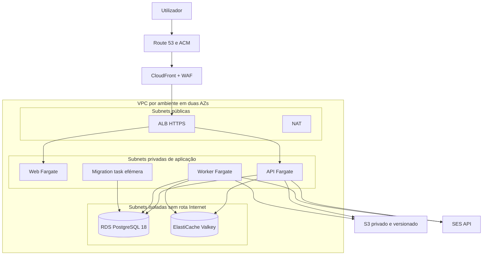

# Arquitetura AWS do piloto
Estado: CONFIGURED como Terraform; nenhum recurso AWS implantado. Região de aplicação af-south-1; certificado da CloudFront e WAF global em us-east-1. Preferir contas distintas por ambiente. O provider exige o ID da conta autorizada, inclusive para o provider global.

A entrada ALB aceita o prefix list de origens CloudFront em 443 e exige cabeçalho de origem. A distribuição redireciona HTTP e desativa caching de conteúdo da aplicação. O listener encaminha `/api/*` e health para API, o resto para Web. Tasks sem IP público. PostgreSQL e Valkey só aceitam os security groups autorizados. S3 usa gateway endpoint; restantes APIs AWS usam HTTPS pelo NAT. Duas AZs e dois NATs em produção por padrão; um NAT em staging reduz custo e disponibilidade. Não ativar AWS antes de rever custos, classes disponíveis e quotas na conta real.

RDS cifra com KMS, força TLS, mantém backups 14 dias em produção (7 em staging), têm proteção de eliminação e snapshot final. Multi-AZ é configurável. Valkey 8.2 usa TLS/autenticação e noeviction para BullMQ. Dimensionamento inicial: DB_POOL_MAX=5 por instância Prisma; contar API, **ambos** os contextos Prisma do worker, tasks antigas durante rollout de 200%, migrations e operadores. Confirmar max_connections e margem antes de aumentar tasks.

Documentos e originais permanentes em `projects/`; reservas em `temporary/`, relatórios em `reports/`, exportações em `exports/`. Apenas prefixes temporários expiram automaticamente. Acesso por task role, SSE-KMS e TLS. O download volta a verificar autorização do domínio antes de ler o objeto. Versões antigas têm retenção própria.

[Backend S3 e lockfile](https://developer.hashicorp.com/terraform/language/backend/s3) · [SES regional: API disponível, SMTP não disponível em Cape Town](https://docs.aws.amazon.com/general/latest/gr/ses.html).
